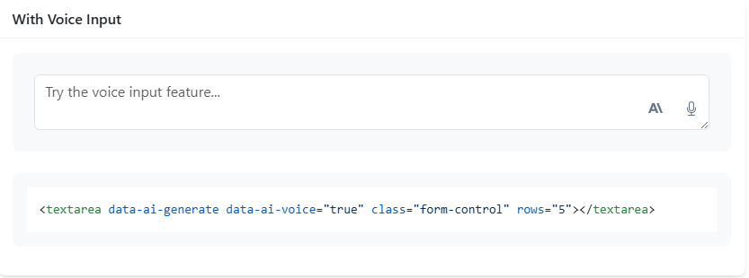

# AI Description Generator

An enterprise-ready, production-hardened jQuery plugin that equips any textarea with contextual AI content generation, integrated speech-to-text dictation, and modal awareness.



---

## ⚡ Highlights

- **Context-Aware Prompts:** Automatically captures selected text or existing textarea contents into the generation prompt.
- **Voice Recognition:** In-built Web Speech API support for real-time dictation without extra dependencies.
- **Security First:** Strict DOMPurify integration for HTML output, CSRF header synchronization, and header sanitation against token leakages.
- **Strict CSP Compliant:** Zero runtime inline style injections; fully compatible with modern Content Security Policies.
- **Clean Lifecycle Control:** Full programmatic attachment, granular single-element `destroy`, and automated MutationObserver DOM tracking.
- **Bootstrap 5 & Dialog Native:** Detects parent dialogs/modals and intelligently stacks over them without z-index collisions.

---

## 📦 Installation

### Via NPM
```bash
npm install ai-description-generator
```

### Via CDN (jsDelivr / unpkg)
```html
<!-- Stylesheet -->
<link rel="stylesheet" href="https://cdn.jsdelivr.net/npm/ai-description-generator@4.1.0/css/ai.description.generator.min.css">

<!-- Scripts (jQuery 3.x required) -->
<script src="https://code.jquery.com/jquery-3.7.1.min.js"></script>
<script src="https://cdn.jsdelivr.net/npm/ai-description-generator@4.1.0/js/ai.description.generator.min.js"></script>

<!-- Optional: DOMPurify (required only when requesting HTML outputs) -->
<script src="https://cdnjs.cloudflare.com/ajax/libs/dompurify/3.0.6/purify.min.js"></script>
```

---

## 🚀 Quick Start

### 1. Declarative Markup
Simply add `data-ai-generate` to any textarea. The built-in observer auto-attaches buttons on page load or DOM mutations:

```html
<textarea data-ai-generate class="form-control" rows="4" placeholder="Enter notes..."></textarea>
```

To enable speech-to-text beside the generation trigger:
```html
<textarea data-ai-generate data-ai-voice="true" class="form-control" rows="4"></textarea>
```

For rich HTML generation:
```html
<textarea data-ai-generate data-ai-response="html" class="form-control" rows="4"></textarea>
```

---

### 2. Programmatic Usage (jQuery)

```javascript
// Initialize on a specific element
$('#product-description').aiDescriptionGenerator();

// Initialize with custom localized strings
$('#notes').aiDescriptionGenerator({
    i18n: {
        title: 'Draft Assistant',
        generate: 'Create'
    }
});

// Cleanly detach and remove UI elements
$('#product-description').aiDescriptionGenerator('destroy');
```

---

## ⚙️ Configuration Options

Initialize globally via `AIGenerator.init(options)`:

| Option | Type | Default | Description |
| :--- | :--- | :--- | :--- |
| `apiEndpoint` | `String` | `'/api/ai/generate'` | Backend API endpoint handling prompt generation. |
| `apiMethod` | `String` | `'POST'` | HTTP method for generation requests. |
| `apiHeaders` | `Object` | `{}` | Custom request headers (auth headers are stripped for security). |
| `defaultMaxTokens` | `Number` | `200` | Default token length selector value. |
| `defaultTemperature` | `Number` | `0.7` | Default creativity index (0.3, 0.7, 1.0). |
| `cooldownMs` | `Number` | `2000` | Minimum interval (in ms) enforced between requests to deter spam. |
| `timeout` | `Number` | `60000` | Request timeout before triggering an AbortController. |
| `closeOnOutsideClick` | `Boolean` | `false` | Whether clicking outside the modal dismisses it. |
| `prefill.enabled` | `Boolean` | `true` | Copies highlighted text into the prompt textarea. |
| `prefill.maxLength` | `Number` | `500` | Max characters grabbed from textarea content. |

---

## 🔌 Public JavaScript API

```javascript
// Global initialization & configuration
AIGenerator.init({ apiEndpoint: '/api/v1/generator' });

// Detach an individual textarea
AIGenerator.detach('#my-textarea');

// Destroy all instances, observers, and DOM additions across the page
AIGenerator.destroy();
```

---

## 📡 Backend API Contract

Your backend endpoint should handle a POST request containing:

```json
{
  "prompt": "Write a release summary...",
  "maxLength": 200,
  "responseFormat": "text",
  "temperature": 0.7
}
```

And respond with a JSON payload:

```json
{
  "status": "success",
  "content": "Generated text response from your AI model..."
}
```

---

## 🔔 Lifecycle Events

Listen directly on target `<textarea>` elements:

```javascript
$('textarea').on('aiContentGenerated', function(e, content) {
    console.log('AI generation completed:', content);
});

$('textarea').on('aiContentInserted', function(e, text) {
    console.log('Content applied into textarea:', text);
});
```

---

## 🛠️ Build & Development

```bash
# Minify JavaScript and CSS bundles
npm run build
```

---

## 📄 License

This project is licensed under the [MIT License](LICENSE).
